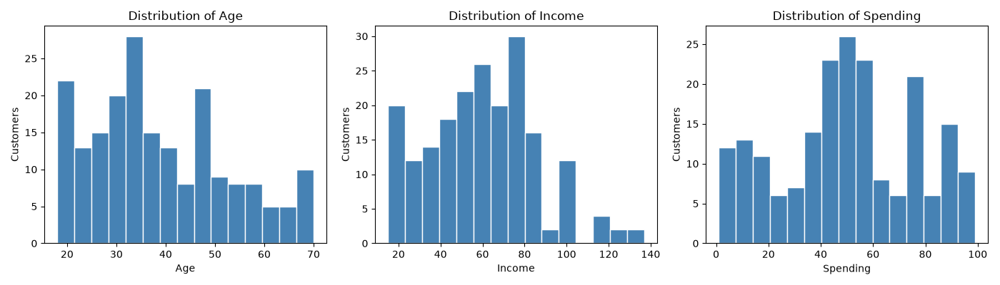
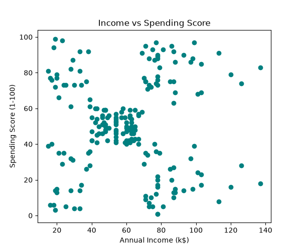
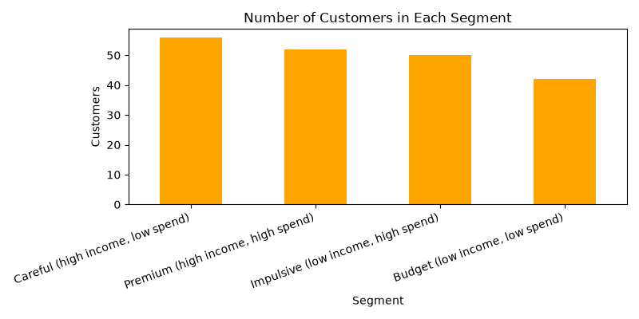
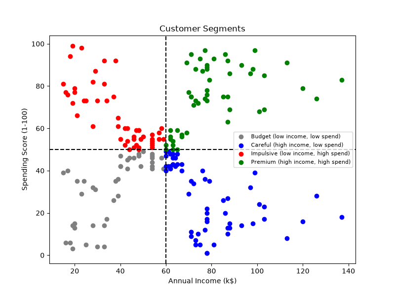

# Customer Segmentation Analysis

## Project Overview
This project analyzes mall customer data using annual income and spending scores to divide customers into four segments. It also explores customer demographics and visualizes customer behavior using Python.

## Objectives
- Load and inspect the mall customers dataset.
- Check data types, missing values, duplicate rows, and summary statistics.
- Explore customer age, annual income, spending score, and gender.
- Classify customers into four rule-based segments.
- Compare segment profiles and spending patterns across age groups.
- Visualize the results and export the segmented dataset to CSV.

## Technologies Used
- Python
- Pandas
- Matplotlib

## Dataset
The project uses the Mall Customers dataset, containing customer IDs, gender, age, annual income, and spending scores.

The script attempts to download the dataset from an online source. If downloading fails, place `Mall_Customers.csv` in the same directory as `customer_segmentation.py`.

Dataset source: [Customer Segmentation Tutorial – Kaggle](https://www.kaggle.com/datasets/vjchoudhary7/customer-segmentation-tutorial-in-python)

## Customer Segments
Customers are divided into four groups using an annual income cutoff of 60 (thousand dollars) and a spending score cutoff of 50.

| Segment | Rule |
|---|---|
| Premium | Income ≥ 60 and spending score ≥ 50 |
| Careful | Income ≥ 60 and spending score < 50 |
| Impulsive | Income < 60 and spending score ≥ 50 |
| Budget | Income < 60 and spending score < 50 |

These are rule-based segments, not clusters generated by a machine-learning algorithm.

The script also groups customers by age using the categories `18-25`, `26-35`, `36-50`, and `50+`.

## Installation
1. Install Python 3.
2. Install the required libraries:

   ```bash
   pip install pandas matplotlib
   ```

3. Keep `customer_segmentation.py` in your project directory.

## How to Run
Open a terminal or Command Prompt in the project directory and run:

```bash
python customer_segmentation.py
```

The script prints dataset information, exploratory analysis, segment counts, segment profiles, and average spending scores by age group. It also generates visualizations and saves the processed dataset.

A working internet connection is required to download the dataset unless `Mall_Customers.csv` is already available locally.

## Results and Output

All generated output files are stored in the `outputs` folder.

### 1. Customer Distributions
Shows the distributions of customer age, annual income, and spending score.



### 2. Annual Income vs Spending Score
Visualizes the relationship between annual income and customer spending score.



### 3. Customer Segment Sizes
Compares the number of customers in each segment.



### 4. Customer Segments Visualization
Displays customers grouped by annual income and spending score.



### Processed Dataset
The CSV file contains the customer data with the additional `Segment` and `AgeGroup` columns.

[View or download customers_with_segments.csv](outputs/customers_with_segments.csv)

## Project Workflow
1. Load the dataset.
2. Standardize selected column names.
3. Inspect and summarize the data.
4. Perform exploratory data analysis.
5. Assign rule-based customer segments.
6. Summarize and visualize segment characteristics.
7. Save the graphs and processed dataset in the `outputs` folder.

## Notes and Limitations
- Missing values and duplicate rows are reported but are not automatically removed or imputed.
- Segment assignments depend on the selected income and spending cutoffs.
- The project uses fixed rules rather than a clustering algorithm such as K-Means.
- Results depend on the dataset successfully loading and the output directory being available.
